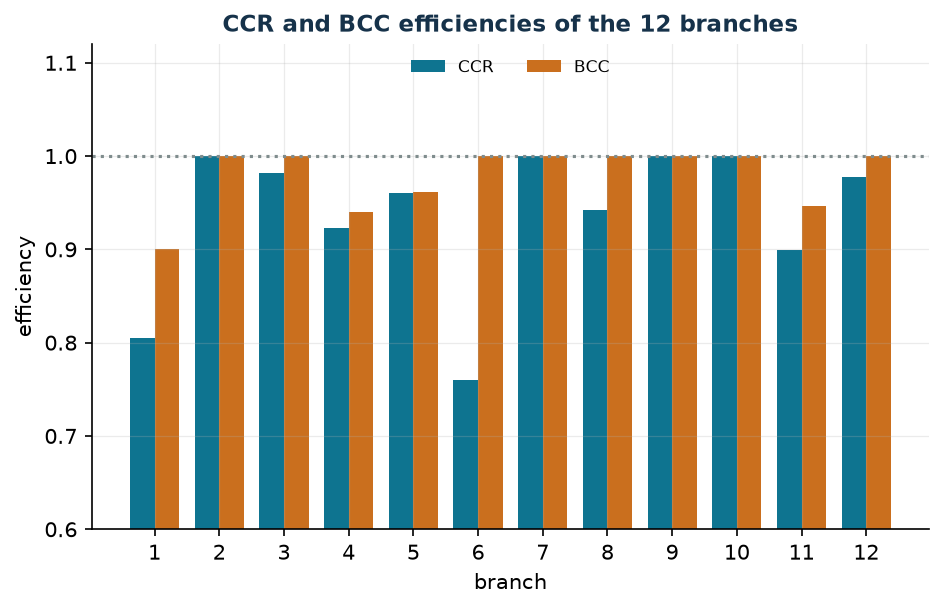
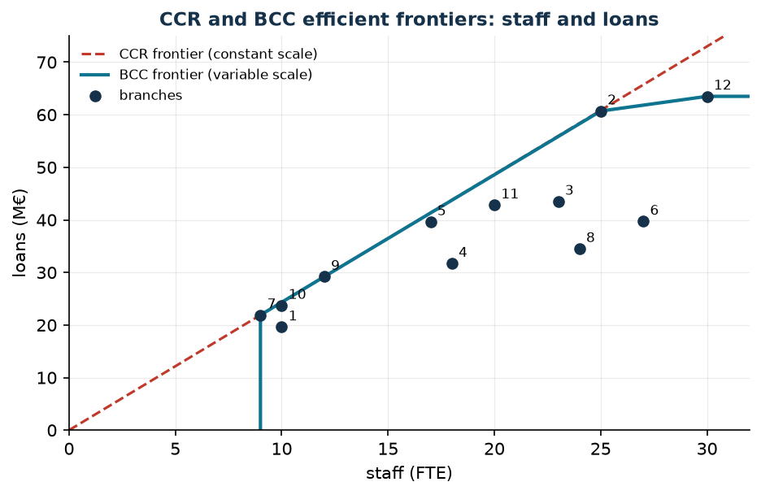

# Data Envelopment Analysis

[:material-file-pdf-box: Lecture notes (PDF)](pdf/operations-research-lab-notes.pdf) · [:material-presentation: Chapter slides (PDF)](pdf/slides-12-dea.pdf)

**Class:** LP · **Script:** `python/lab12_dea.py`

[](https://colab.research.google.com/github/fabiofurini/operations-research-lab/blob/main/notebooks/lab12_dea.ipynb)

A bank has twelve branches: they use staff and operating costs and produce loans and
deposits. Which ones perform well, and by how much should the others reduce their
resources? The outputs have no common price, and a large branch is not inefficient just
because it spends more.

**Data Envelopment Analysis** (DEA) compares each branch with the best observed
practices by solving one LP per branch, without fixing in advance how much a million of
deposits is worth compared with a million of loans.

## Units, inputs, outputs and efficiency

The units being compared are called DMUs (*Decision Making Units*).

**Data (input of the model).**

| Symbol | Type | Meaning |
|---|---|---|
| $n$ | $\in \mathbb{Z}_{\ge 1}$ | number of DMUs; the DMUs are indexed by $j \in \{1, 2, \dots, n\}$ |
| $m$ | $\in \mathbb{Z}_{\ge 1}$ | number of inputs; the inputs are indexed by $i \in \{1, 2, \dots, m\}$ |
| $p$ | $\in \mathbb{Z}_{\ge 1}$ | number of outputs; the outputs are indexed by $r \in \{1, 2, \dots, p\}$ |
| $x_{ij}$ | $\in \mathbb{Q}_{> 0}$ | amount of input $i$ used by DMU $j$ |
| $y_{rj}$ | $\in \mathbb{Q}_{> 0}$ | amount of output $r$ produced by DMU $j$ |
| $o$ | $\in \{1, 2, \dots, n\}$ | the DMU being evaluated |

Here $x$ and $y$ are **data**, not variables: this is the standard DEA notation.

!!! info "Definition 12.1 — Relative efficiency"
    Given weights $u_r \ge 0$ and $v_i \ge 0$, not all zero, the *efficiency ratio* of
    DMU $j$ is

    $$
    E_j(u, v) = \frac{\sum_{r=1}^{p} u_r\, y_{rj}}{\sum_{i=1}^{m} v_i\, x_{ij}} .
    $$

    The *relative efficiency* of DMU $o$ is the maximum of $E_o(u, v)$ over the weights
    for which no DMU has a ratio greater than $1$. DMU $o$ is *efficient* if its
    relative efficiency equals $1$.

## The input-oriented CCR model

The model of Charnes, Cooper and Rhodes (CCR) measures how much the inputs can be
reduced while leaving the outputs unchanged.

**The problem in words.** *We decide* the weights of the inputs and of the outputs.
*The objective* is to maximise the efficiency ratio of DMU $o$. *The constraints*
require that, with those same weights, no DMU has a ratio greater than $1$.

**Decision variables.** We introduce the following $p + m$ non-negative variables:

$$
\begin{cases}
u_r = \text{weight of output } r, & \forall r \in \{1, 2, \dots, p\},\\[1ex]
v_i = \text{weight of input } i, & \forall i \in \{1, 2, \dots, m\}.
\end{cases}
$$

Using these variables, the fractional model for DMU $o$ is the following:

$$
\begin{aligned}
\max ~~ \frac{\sum_{r=1}^{p} u_r\, y_{ro}}{\sum_{i=1}^{m} v_i\, x_{io}} & & \\
\text{subject to} \quad \frac{\sum_{r=1}^{p} u_r\, y_{rj}}{\sum_{i=1}^{m} v_i\, x_{ij}} &\le 1, & \forall j \in \{1, 2, \dots, n\}, \\
u_r &\ge 0, & \forall r \in \{1, 2, \dots, p\}, \\
v_i &\ge 0, & \forall i \in \{1, 2, \dots, m\}.
\end{aligned}
$$

The model is not linear, but if all the weights are multiplied by the same $t > 0$ no
ratio changes. Fixing $\sum_{i=1}^{m} v_i\, x_{io} = 1$ (the **Charnes–Cooper**
transformation) gives the following LP, called the *multiplier form*:

$$
\begin{aligned}
\max ~~ \sum_{r=1}^{p} u_r\, y_{ro} & & \\
\text{subject to} \quad \sum_{i=1}^{m} v_i\, x_{io} &= 1, & \\
\sum_{r=1}^{p} u_r\, y_{rj} - \sum_{i=1}^{m} v_i\, x_{ij} &\le 0, & \forall j \in \{1, 2, \dots, n\}, \\
u_r &\ge 0, & \forall r \in \{1, 2, \dots, p\}, \\
v_i &\ge 0, & \forall i \in \{1, 2, \dots, m\}.
\end{aligned}
$$

Description of the objective function and of the constraints:

- the linear objective function maximises the weighted output of DMU $o$, which is its
  efficiency ratio because the weighted input equals $1$;
- the linear **normalisation** constraint fixes the weighted input of DMU $o$ to $1$
  ($1$ linear constraint);
- the linear **ratio** constraints require that for every DMU the weighted output does
  not exceed the weighted input ($n$ linear constraints);
- the non-negativity constraints on $u_r$ and $v_i$ define the variables of the model.

The optimal value $\tilde h_o \in (0, 1]$ is the relative efficiency of DMU $o$; for $n$
DMUs we solve $n$ LPs.

## The envelopment form: the dual

The dual of the multiplier form has a free variable $\theta$ for the normalisation
constraint and a variable $\lambda_j \ge 0$ for each ratio constraint (to follow the
literature they are not called $\pi$). The theory is in the chapter
[Duality theory](https://fabiofurini.github.io/linear-programming/duality/09-duality/)
of the Linear Programming course.

$$
\begin{aligned}
\min ~~ \theta & & \\
\text{subject to} \quad \theta\, x_{io} - \sum_{j=1}^{n} \lambda_j\, x_{ij} &\ge 0, & \forall i \in \{1, 2, \dots, m\}, \\
\sum_{j=1}^{n} \lambda_j\, y_{rj} &\ge y_{ro}, & \forall r \in \{1, 2, \dots, p\}, \\
\theta &\gtreqless 0, & \\
\lambda_j &\ge 0, & \forall j \in \{1, 2, \dots, n\}.
\end{aligned}
$$

Description of the objective function and of the constraints:

- the linear objective function minimises the factor $\theta$ by which all the inputs
  of DMU $o$ are contracted;
- the linear **input** constraints require that the combination of DMUs weighted by the
  $\lambda_j$ uses at most $\theta$ times each input of $o$ ($m$ linear constraints);
- the linear **output** constraints require that the same combination produces at least
  each output of $o$ ($p$ linear constraints);
- the constraints on $\theta$ and $\lambda_j$ define the variables of the model.

The combination $\sum_{j=1}^{n} \lambda_j\, (x_{\cdot j}, y_{\cdot j})$ is a **virtual**
DMU. With $\lambda_o = 1$ we get $\theta = 1$, hence $\tilde\theta \le 1$, and by strong
duality $\tilde\theta = \tilde h_o$. The solution gives:

- the **peers** of $o$: the DMUs with $\tilde\lambda_j > 0$;
- the **targets**: the projection of $o$ onto the efficient frontier;
- the **shadow prices** of the constraints, which are the optimal weights $\tilde v_i$
  and $\tilde u_r$ of the primal (one of the optimal vectors, if it is not unique).

## The BCC model and scale efficiency

The CCR model assumes constant returns to scale. The model of Banker, Charnes and
Cooper (BCC) adds $\sum_{j=1}^{n} \lambda_j = 1$: the virtual DMU becomes a **convex**
combination, of comparable size.

$$
\begin{aligned}
\min ~~ \theta & & \\
\text{subject to} \quad \theta\, x_{io} - \sum_{j=1}^{n} \lambda_j\, x_{ij} &\ge 0, & \forall i \in \{1, 2, \dots, m\}, \\
\sum_{j=1}^{n} \lambda_j\, y_{rj} &\ge y_{ro}, & \forall r \in \{1, 2, \dots, p\}, \\
\sum_{j=1}^{n} \lambda_j &= 1, & \\
\theta &\gtreqless 0, & \\
\lambda_j &\ge 0, & \forall j \in \{1, 2, \dots, n\}.
\end{aligned}
$$

The convexity constraint shrinks the region, and in a minimisation problem
$\tilde\theta^{\rm BCC} \ge \tilde\theta^{\rm CCR}$.

!!! info "Definition 12.2 — Scale efficiency"
    $$
    \mathrm{SE}_o = \frac{\tilde\theta^{\rm CCR}_o}{\tilde\theta^{\rm BCC}_o} \in (0, 1].
    $$

    It equals $1$ at the most productive scale; it is smaller than $1$ when part of the
    inefficiency depends only on the size of the DMU.

In the CCR model, $\sum_{j=1}^{n} \tilde\lambda_j < 1$ indicates a DMU that is too small
(increasing returns) and $\sum_{j=1}^{n} \tilde\lambda_j > 1$ one that is too large
(decreasing returns), when the solution is unique.

## Slacks and weak and strong efficiency

After the radial contraction a margin may remain on a single input or output: the
**slacks** $s_i^-$ and $s_r^+$. They are computed with a second phase, with
$\tilde\theta$ fixed, using the non-negative variables $\lambda_j$, $s_i^-$ and $s_r^+$:

$$
\begin{aligned}
\max ~~ \sum_{i=1}^{m} s_i^- + \sum_{r=1}^{p} s_r^+ & & \\
\text{subject to} \quad \sum_{j=1}^{n} \lambda_j\, x_{ij} + s_i^- &= \tilde\theta\, x_{io}, & \forall i \in \{1, 2, \dots, m\}, \\
\sum_{j=1}^{n} \lambda_j\, y_{rj} - s_r^+ &= y_{ro}, & \forall r \in \{1, 2, \dots, p\}, \\
\lambda_j &\ge 0, & \forall j \in \{1, 2, \dots, n\}, \\
s_i^- &\ge 0, & \forall i \in \{1, 2, \dots, m\}, \\
s_r^+ &\ge 0, & \forall r \in \{1, 2, \dots, p\}.
\end{aligned}
$$

The targets are $\hat x_{io} = \tilde\theta\, x_{io} - \tilde s_i^-$ and
$\hat y_{ro} = y_{ro} + \tilde s_r^+$.

!!! info "Definition 12.3 — Weak and strong efficiency"
    DMU $o$ is *strongly efficient* if $\tilde\theta = 1$ and all the optimal slacks of
    the second phase are zero. It is *weakly efficient* if $\tilde\theta = 1$ but at
    least one slack is positive.

!!! example "Worked example by hand (5 DMUs, one input and one output)"
    Input $x = (2, 4, 6, 5, 2)$, output $y = (2, 6, 7, 3, 1)$. The solver gives
    $\tilde\theta^{\rm CCR} = (0.6667,\ 1,\ 0.7778,\ 0.4,\ 0.3333)$ and
    $\tilde\theta^{\rm BCC} = (1,\ 1,\ 1,\ 0.5,\ 1)$.

    - **Check of the CCR**: with one input and one output the efficiency is $y/x$
      divided by the best one, $6/4 = 1.5$: for example $\tilde h_3 = (7/6)/1.5 = 0.7778$.
    - **Duality for DMU 1**: $\tilde u_1 = 0.3333$, $\tilde v_1 = 0.5$; the constraint of
      DMU 2 is active ($6 \cdot 0.3333 - 4 \cdot 0.5 = 0$) and DMU 2 is the only peer,
      with $\tilde\lambda_2 = 0.3333$.
    - **BCC for DMU 4**: $\tilde\lambda_1 = 0.75$ and $\tilde\lambda_2 = 0.25$ give input
      $2.5 = 0.5 \cdot 5$ and output $3$.
    - **Weak efficiency**: DMU 5 has $\tilde\theta^{\rm BCC} = 1$, but DMU 1 uses the same
      input and produces $1$ more: slack $\tilde s_1^+ = 1$.

## Case study

Twelve branches, two inputs (staff in FTE, operating costs in k€) and two outputs
(loans and deposits in M€). Realistic synthetic data generated by the script with a
fixed seed, in `data/dea_filiali.csv`.

| branch | 1 | 2 | 3 | 4 | 5 | 6 | 7 | 8 | 9 | 10 | 11 | 12 |
|---|---|---|---|---|---|---|---|---|---|---|---|---|
| staff (FTE) | 10 | 25 | 23 | 18 | 17 | 27 | 9 | 24 | 12 | 10 | 20 | 30 |
| costs (k€) | 720 | 1420 | 1130 | 940 | 990 | 1620 | 640 | 1300 | 690 | 500 | 1020 | 1370 |
| loans (M€) | 19.6 | 60.7 | 43.5 | 31.7 | 39.6 | 39.7 | 21.9 | 34.5 | 29.2 | 23.7 | 42.8 | 63.5 |
| deposits (M€) | 18.5 | 58.7 | 63.0 | 50.5 | 43.2 | 73.1 | 38.0 | 72.7 | 28.7 | 26.3 | 45.7 | 62.9 |

```text
 branch    CCR     BCC   scale    sum lambda (CCR)   returns
      1  0.8055  0.9000  0.8950               0.671   increasing
      2  1.0000  1.0000  1.0000               1.000   constant
      3  0.9815  1.0000  0.9815               1.917   decreasing
      4  0.9233  0.9403  0.9819               1.423   decreasing
      5  0.9604  0.9611  0.9993               1.450   decreasing
      6  0.7600  1.0000  0.7600               1.924   decreasing
      7  1.0000  1.0000  1.0000               1.000   constant
      8  0.9419  1.0000  0.9419               1.913   decreasing
      9  1.0000  1.0000  1.0000               1.000   constant
     10  1.0000  1.0000  1.0000               1.000   constant
     11  0.8997  0.9470  0.9501               1.641   decreasing
     12  0.9779  1.0000  0.9779               2.679   decreasing
CCR-efficient branches: [2, 7, 9, 10]
BCC-efficient branches: [2, 3, 6, 7, 8, 9, 10, 12]
```

For every branch the optimal value of the envelopment form coincides with that of the
multiplier form: strong duality checked numerically.



**Peers and input targets** (CCR, after the second phase; `data/dea_target.csv`):

| branch | $\tilde\theta$ | peers ($j$: $\tilde\lambda_j$) | staff | target | costs | target |
|---|---|---|---|---|---|---|
| 1 | 0.8055 | 9: 0.671 | 10 | 8.05 | 720 | 463.2 |
| 3 | 0.9815 | 7: 1.075; 10: 0.842 | 23 | 18.10 | 1130 | 1109.1 |
| 4 | 0.9233 | 7: 1.119; 10: 0.304 | 18 | 13.11 | 940 | 867.9 |
| 5 | 0.9604 | 7: 0.223; 9: 1.024; 10: 0.203 | 17 | 16.33 | 990 | 950.8 |
| 6 | 0.7600 | 7: 1.924 | 27 | 17.31 | 1620 | 1231.2 |
| 8 | 0.9419 | 7: 1.913 | 24 | 17.22 | 1300 | 1224.4 |
| 11 | 0.8997 | 2: 0.106; 10: 1.535 | 20 | 17.99 | 1020 | 917.7 |
| 12 | 0.9779 | 10: 2.679 | 30 | 26.79 | 1370 | 1339.7 |

!!! tip "What to do branch by branch"
    Branch 6 is the least efficient ($0.76$) but it is efficient in the BCC model: it
    does not work badly, it is **too large** (only peer branch 7 taken $1.924$ times).
    Branch 1 is too small ($\sum \tilde\lambda_j = 0.671$), inefficient also in the BCC
    model ($0.90$), and has a slack of $116.8$ k€ on costs: target $463.2$ k€ against
    $720$.



In the one-input, one-output view (staff and loans) the CCR frontier is the ray with the
best slope, $2.4333$ M€ per FTE of branch 9; the BCC frontier goes through branches 7,
9, 2 and 12. Below the ray a branch pays technical and scale inefficiency, below the
piecewise line only the technical one. In this reduced view the efficiencies differ from
those of the full model.

## Sensitivity

```text
branch 6: theta = 0.7600
  output loans   : y = 39.7 | Pi = 0.00000 | valid for the right-hand side in [-inf, 42.13]
  output deposits: y = 73.1 | Pi = 0.01040 | valid for the right-hand side in [68.89, inf]
Check: right-hand side of deposits from 73.1 to 74.1 -> theta from 0.7600 to 0.7704 (change +0.01040 = Pi 0.01040)
Comparison: primal weight u = (0.00000, 0.01040)
```

Increasing the right-hand side of a $\ge$ constraint shrinks the region, and in a
minimisation problem $\tilde\theta$ cannot decrease: the shadow prices are $\ge 0$. The
shadow price of deposits is the weight $\tilde u_2$ of the primal, and the perturbation
confirms it. That of loans is zero up to $42.13$: the virtual DMU already produces
$2.43$ million of loans more (the slack of the second phase).

```text
  branch  3: CCR 0.9815 -> 1.0000  <- changes
  branch  4: CCR 0.9233 -> 0.9795  <- changes
  branch  5: CCR 0.9604 -> 0.9791  <- changes
  branch  6: CCR 0.7600 -> 0.9156  <- changes
  branch  8: CCR 0.9419 -> 1.0000  <- changes
Without branch 7: 5 branches change efficiency; newly efficient: [3, 8]
```

!!! warning "Efficiency is relative"
    A single DMU on the frontier can change the verdict on many others. Before acting on
    the targets it is worth checking the data of the most cited peers and repeating the
    analysis without them.

## Code

The complete script of the chapter — data, models, duality, sensitivity and figures —
is [`python/lab12_dea.py`](https://github.com/fabiofurini/operations-research-lab/blob/main/python/lab12_dea.py)
(reproducible with `python3 python/lab12_dea.py` from the `python/` folder).

The same code is also available as a notebook — [`notebooks/lab12_dea.ipynb`](https://github.com/fabiofurini/operations-research-lab/blob/main/notebooks/lab12_dea.ipynb) — which opens in Colab from the badge at the top of the page and runs in the browser, with nothing to install.

??? example "Show the full script — `lab12_dea.py`"

    ```python
    """Chapter 12 — Data Envelopment Analysis (LP).

    Case study: 12 branches of a bank (branches 1, 2, ..., 12) compared on
    2 inputs (staff in FTE, operating costs in thousands of €) and 2 outputs
    (loans and deposits in millions of €). Realistic synthetic data generated
    with a fixed seed.

    Contents:
      1. Branch data (generator with a fixed seed)
      2. Worked example: 5 units, one input and one output
      3. Input-oriented CCR: multiplier form (primal)
      4. CCR: envelopment form (dual), theta = efficiency, peers and lambda
      5. BCC (variable returns to scale) and scale efficiency
      6. Slacks, weak and strong efficiency, input targets
      7. Sensitivity: shadow prices verified by perturbation, and stability
      8. Figures (data for pgfplots + matplotlib preview)
    """
    import gurobipy as gp
    import numpy as np
    import pandas as pd
    from gurobipy import GRB

    from stile import (ARANCIO, BLU, GRIGIO, ROSSO, TEAL, intestazione, plt, salva_dat,
                       salva_dati, salva_figura)

    TOL = 1e-6

    # ----------------------------------------------------------------------
    # 1. BRANCH DATA
    # ----------------------------------------------------------------------
    # Generator: staff between 8 and 30 FTE; costs proportional to staff with a
    # fixed share; outputs from a production function with decreasing returns to
    # scale, multiplied by a random inefficiency exp(-|N(0, 0.25)|) and split
    # between loans and deposits.
    rng = np.random.default_rng(42)
    n = 12                                                    # branches
    personale = rng.integers(8, 31, n).astype(float)          # FTE
    costi = np.round(personale * rng.uniform(38, 52, n) + rng.uniform(80, 260, n), -1)  # k€
    efficienza_vera = np.exp(-np.abs(rng.normal(0, 0.25, n)))
    volume = 9.0 * personale ** 0.55 * (costi / 100) ** 0.30 * efficienza_vera
    quota = rng.uniform(0.38, 0.62, n)
    prestiti = np.round(volume * quota, 1)                    # M€
    depositi = np.round(volume * (1 - quota) * 1.3, 1)        # M€

    filiali = list(range(1, n + 1))
    X = np.vstack([personale, costi])                         # inputs:  m x n
    Y = np.vstack([prestiti, depositi])                       # outputs: p x n
    nomi_in = ["staff", "costs"]
    nomi_out = ["loans", "deposits"]

    dati = pd.DataFrame({"branch": filiali, "staff": personale.astype(int),
                         "operating_costs": costi.astype(int),
                         "loans": prestiti, "deposits": depositi})
    salva_dati(dati, "dea_filiali")
    intestazione("Branch data")
    print(dati.to_string(index=False))


    def moltiplicatori(X, Y, o):
        """Input-oriented CCR, multiplier form (Charnes-Cooper LP)."""
        m_, n_ = X.shape
        p_ = Y.shape[0]
        md = gp.Model("dea_multipliers")
        md.Params.OutputFlag = 0
        md.Params.FeasibilityTol = 1e-9
        md.Params.OptimalityTol = 1e-9
        u = md.addVars(p_, name="u")                            # output weights
        v = md.addVars(m_, name="v")                            # input weights
        norm = md.addConstr(gp.quicksum(v[i] * X[i, o] for i in range(m_)) == 1,
                            name="normalisation")
        rapp = md.addConstrs(
            (gp.quicksum(u[r] * Y[r, j] for r in range(p_))
             - gp.quicksum(v[i] * X[i, j] for i in range(m_)) <= 0 for j in range(n_)),
            name="ratio")
        md.setObjective(gp.quicksum(u[r] * Y[r, o] for r in range(p_)), GRB.MAXIMIZE)
        md.optimize()
        assert md.Status == GRB.OPTIMAL
        return (md.ObjVal, np.array([u[r].X for r in range(p_)]),
                np.array([v[i].X for i in range(m_)]), norm.Pi,
                np.array([rapp[j].Pi for j in range(n_)]))


    def inviluppo(X, Y, o, vrs=False, rhs_out=None):
        """Input-oriented envelopment form: CCR (vrs=False) or BCC (vrs=True).

        rhs_out, if given, replaces the right-hand side of the output constraints."""
        m_, n_ = X.shape
        p_ = Y.shape[0]
        md = gp.Model("dea_envelopment")
        md.Params.OutputFlag = 0
        md.Params.FeasibilityTol = 1e-9
        md.Params.OptimalityTol = 1e-9
        theta = md.addVar(lb=-GRB.INFINITY, name="theta")
        lam = md.addVars(n_, name="lambda")
        c_in = md.addConstrs(
            (theta * X[i, o] - gp.quicksum(lam[j] * X[i, j] for j in range(n_)) >= 0
             for i in range(m_)), name="input")
        b = Y[:, o] if rhs_out is None else rhs_out
        c_out = md.addConstrs(
            (gp.quicksum(lam[j] * Y[r, j] for j in range(n_)) >= b[r] for r in range(p_)),
            name="output")
        if vrs:
            md.addConstr(lam.sum() == 1, name="convexity")
        md.setObjective(theta, GRB.MINIMIZE)
        md.optimize()
        assert md.Status == GRB.OPTIMAL
        return md, theta, lam, c_in, c_out


    def scarti(X, Y, o, theta, vrs=False):
        """Second phase: with theta fixed, maximise the sum of the slacks."""
        m_, n_ = X.shape
        p_ = Y.shape[0]
        md = gp.Model("dea_slacks")
        md.Params.OutputFlag = 0
        md.Params.FeasibilityTol = 1e-9
        md.Params.OptimalityTol = 1e-9
        lam = md.addVars(n_, name="lambda")
        s_in = md.addVars(m_, name="s_minus")
        s_out = md.addVars(p_, name="s_plus")
        md.addConstrs((gp.quicksum(lam[j] * X[i, j] for j in range(n_)) + s_in[i]
                       == theta * X[i, o] for i in range(m_)), name="input")
        md.addConstrs((gp.quicksum(lam[j] * Y[r, j] for j in range(n_)) - s_out[r]
                       == Y[r, o] for r in range(p_)), name="output")
        if vrs:
            md.addConstr(lam.sum() == 1, name="convexity")
        md.setObjective(s_in.sum() + s_out.sum(), GRB.MAXIMIZE)
        md.optimize()
        assert md.Status == GRB.OPTIMAL
        pulisci = lambda a: np.where(np.abs(a) < TOL, 0.0, a)
        return (pulisci(np.array([lam[j].X for j in range(n_)])),
                pulisci(np.array([s_in[i].X for i in range(m_)])),
                pulisci(np.array([s_out[r].X for r in range(p_)])))


    def testo_peer(lam):
        return " ".join(f"{j + 1}:{l:.3f}" for j, l in enumerate(lam) if l > TOL)


    # ----------------------------------------------------------------------
    # 2. WORKED EXAMPLE: 5 units, one input and one output
    # ----------------------------------------------------------------------
    intestazione("Worked example: 5 units, one input and one output")
    Xe = np.array([[2.0, 4.0, 6.0, 5.0, 2.0]])
    Ye = np.array([[2.0, 6.0, 7.0, 3.0, 1.0]])
    for o in range(Xe.shape[1]):
        h, u, v, pi_norm, pi_rapp = moltiplicatori(Xe, Ye, o)
        md, th, lam, _, _ = inviluppo(Xe, Ye, o)
        mb, thb, _, _, _ = inviluppo(Xe, Ye, o, vrs=True)
        lam_b, sm_b, sp_b = scarti(Xe, Ye, o, thb.X, vrs=True)
        lam_c, _, _ = scarti(Xe, Ye, o, th.X)
        print(f"unit {o + 1}: x = {Xe[0, o]:.0f}, y = {Ye[0, o]:.0f}, y/x = {Ye[0, o] / Xe[0, o]:.4f} | "
              f"CCR h = {h:.4f} (u = {u[0]:.4f}, v = {v[0]:.4f}), theta = {th.X:.4f}, "
              f"lambda = {testo_peer(lam_c)} | "
              f"BCC theta = {thb.X:.4f}, lambda = {testo_peer(lam_b)}, "
              f"output slack = {sp_b[0]:.4f}")

    # ----------------------------------------------------------------------
    # 3. CCR: MULTIPLIER FORM (primal)
    # ----------------------------------------------------------------------
    intestazione("Input-oriented CCR: multiplier form")
    ris = {}
    for o in range(n):
        h, u, v, pi_norm, pi_rapp = moltiplicatori(X, Y, o)
        ris[o] = {"h": h, "u": u, "v": v, "pi_norm": pi_norm, "pi_rapp": pi_rapp}
        print(f"branch {o + 1:2d}: h = {h:.4f} | u = ({u[0]:.5f}, {u[1]:.5f}) "
              f"v = ({v[0]:.5f}, {v[1]:.6f}) | Pi normalisation = {pi_norm:.4f}")

    # ----------------------------------------------------------------------
    # 4. CCR: ENVELOPMENT FORM (dual), peers and lambda
    # ----------------------------------------------------------------------
    intestazione("CCR: envelopment form (dual) and comparison with the multipliers")
    for o in range(n):
        md, th, lam, c_in, c_out = inviluppo(X, Y, o)
        ris[o]["ccr"] = th.X
        # strong duality: theta = h; the Pi of the envelopment form are weights u and v
        assert abs(th.X - ris[o]["h"]) < 1e-7
        assert abs(ris[o]["pi_norm"] - th.X) < 1e-7
        pi_in = np.array([c_in[i].Pi for i in range(2)])
        pi_out = np.array([c_out[r].Pi for r in range(2)])
        print(f"branch {o + 1:2d}: theta = {th.X:.4f} = h = {ris[o]['h']:.4f} | "
              f"Pi output = ({pi_out[0]:.5f}, {pi_out[1]:.5f}) "
              f"Pi input = ({pi_in[0]:.5f}, {pi_in[1]:.6f})")
    print("Check: theta (envelopment) = h (multipliers) and Pi of the normalisation = theta "
          "for all 12 branches.")

    # ----------------------------------------------------------------------
    # 5. BCC (variable returns to scale) and scale efficiency
    # ----------------------------------------------------------------------
    intestazione("CCR, BCC and scale efficiencies")
    print(" branch    CCR     BCC   scale    sum lambda (CCR)   returns")
    righe_eff = []
    for o in range(n):
        mb, thb, _, _, _ = inviluppo(X, Y, o, vrs=True)
        lam, s_in, s_out = scarti(X, Y, o, ris[o]["ccr"])
        ris[o].update({"bcc": thb.X, "lam": lam, "s_in": s_in, "s_out": s_out})
        scala = ris[o]["ccr"] / thb.X
        somma = lam.sum()
        if abs(ris[o]["ccr"] - 1) < TOL:
            rts = "constant"
        else:
            rts = "increasing" if somma < 1 - TOL else ("decreasing" if somma > 1 + TOL else "constant")
        righe_eff.append((o + 1, ris[o]["ccr"], thb.X, scala, somma))
        print(f"{o + 1:7d}  {ris[o]['ccr']:.4f}  {thb.X:.4f}  {scala:.4f}  {somma:18.3f}   {rts}")
    eff = pd.DataFrame(righe_eff, columns=["branch", "ccr", "bcc", "scale", "sum_lambda"])
    salva_dati(eff.round(6), "dea_efficienze")
    print(f"CCR-efficient branches: {[o + 1 for o in range(n) if abs(ris[o]['ccr'] - 1) < TOL]}")
    print(f"BCC-efficient branches: {[o + 1 for o in range(n) if abs(ris[o]['bcc'] - 1) < TOL]}")
    print(f"Mean CCR efficiency: {eff['ccr'].mean():.4f}; mean BCC: {eff['bcc'].mean():.4f}")

    # ----------------------------------------------------------------------
    # 6. SLACKS, WEAK AND STRONG EFFICIENCY, TARGETS
    # ----------------------------------------------------------------------
    intestazione("Slacks and input targets (CCR, second phase)")
    righe_t = []
    for o in range(n):
        r = ris[o]
        deb = abs(r["ccr"] - 1) < TOL and (r["s_in"].sum() + r["s_out"].sum()) > TOL
        if deb:
            print(f"branch {o + 1}: weakly efficient (theta = 1 with positive slacks)")
        if abs(r["ccr"] - 1) < TOL:
            continue
        t_in = r["ccr"] * X[:, o] - r["s_in"]
        t_out = Y[:, o] + r["s_out"]
        righe_t.append((o + 1, r["ccr"], testo_peer(r["lam"]), *t_in, *t_out, *r["s_in"], *r["s_out"]))
        print(f"branch {o + 1:2d}: theta = {r['ccr']:.4f} | peers {testo_peer(r['lam'])} | "
              f"input slacks ({r['s_in'][0]:.2f}, {r['s_in'][1]:.2f}) output ({r['s_out'][0]:.2f}, {r['s_out'][1]:.2f}) | "
              f"target staff {t_in[0]:.2f} (from {X[0, o]:.0f}), costs {t_in[1]:.1f} (from {X[1, o]:.0f})")
    deboli = [o + 1 for o in range(n) if abs(ris[o]["ccr"] - 1) < TOL
              and ris[o]["s_in"].sum() + ris[o]["s_out"].sum() > TOL]
    print(f"Efficient branches with positive slacks (weakly efficient): {deboli if deboli else 'none'}")
    target = pd.DataFrame(righe_t, columns=[
        "branch", "theta", "peers", "staff_target", "costs_target", "loans_target",
        "deposits_target", "slack_staff", "slack_costs", "slack_loans", "slack_deposits"])
    salva_dati(target.round(4), "dea_target")

    efficienti = [j for j in range(n) if abs(ris[j]["ccr"] - 1) < TOL]
    conta = {j + 1: sum(1 for o in range(n) if abs(ris[o]["ccr"] - 1) > TOL and ris[o]["lam"][j] > TOL)
             for j in efficienti}
    print("How many times each efficient branch is a peer of an inefficient one: "
          + ", ".join(f"{j}: {c}" for j, c in conta.items()))

    # ----------------------------------------------------------------------
    # 7. SENSITIVITY: shadow prices verified by perturbation, and stability
    # ----------------------------------------------------------------------
    intestazione("Sensitivity: shadow prices of the output constraints (least efficient branch)")
    o_min = int(eff["ccr"].idxmin())
    md, th, lam, c_in, c_out = inviluppo(X, Y, o_min)
    print(f"branch {o_min + 1}: theta = {th.X:.4f}")
    for r in range(2):
        c = c_out[r]
        print(f"  output {nomi_out[r]:8s}: y = {Y[r, o_min]:.1f} | Pi = {c.Pi:.5f} | "
              f"valid for the right-hand side in [{c.SARHSLow:.2f}, {c.SARHSUp:.2f}]")
    r_star = int(np.argmax([c_out[r].Pi for r in range(2)]))
    nuovo = Y[:, o_min].copy()
    nuovo[r_star] += 1
    md2, th2, _, _, _ = inviluppo(X, Y, o_min, rhs_out=nuovo)
    print(f"Check: right-hand side of {nomi_out[r_star]} from {Y[r_star, o_min]:.1f} to {nuovo[r_star]:.1f} "
          f"-> theta from {th.X:.4f} to {th2.X:.4f} (change {th2.X - th.X:+.5f} = Pi {c_out[r_star].Pi:.5f})")
    print(f"Comparison: primal weight u = ({ris[o_min]['u'][0]:.5f}, {ris[o_min]['u'][1]:.5f})")

    intestazione("Stability: remove the most cited peer and recompute the CCR")
    j_peer = max(conta, key=conta.get) - 1
    resto = [j for j in range(n) if j != j_peer]
    Xr, Yr = X[:, resto], Y[:, resto]
    cambi = []
    for k, o in enumerate(resto):
        md, th, _, _, _ = inviluppo(Xr, Yr, k)
        cambi.append((o + 1, ris[o]["ccr"], th.X))
        seg = "  <- changes" if th.X - ris[o]["ccr"] > 1e-6 else ""
        print(f"  branch {o + 1:2d}: CCR {ris[o]['ccr']:.4f} -> {th.X:.4f}{seg}")
    print(f"Without branch {j_peer + 1}: {sum(1 for c in cambi if c[2] - c[1] > 1e-6)} branches "
          f"change efficiency; newly efficient: "
          f"{[c[0] for c in cambi if abs(c[2] - 1) < TOL and abs(c[1] - 1) > TOL]}")

    # ----------------------------------------------------------------------
    # 8. FIGURES (data for pgfplots + matplotlib preview)
    # ----------------------------------------------------------------------
    salva_dat(eff[["branch", "ccr", "bcc"]], "cap12_efficienze")

    # one-input, one-output view: staff -> loans
    Xp, Yp = X[[0], :], Y[[0], :]
    bcc_p = []
    for o in range(n):
        md, th, _, _, _ = inviluppo(Xp, Yp, o, vrs=True)
        _, s_in, s_out = scarti(Xp, Yp, o, th.X, vrs=True)
        bcc_p.append((th.X, s_in.sum() + s_out.sum()))
    ccr_p = []
    for o in range(n):
        md, th, _, _, _ = inviluppo(Xp, Yp, o)
        ccr_p.append(th.X)
    frontiera = sorted((Xp[0, o], Yp[0, o]) for o in range(n)
                       if abs(bcc_p[o][0] - 1) < TOL and bcc_p[o][1] < TOL)
    pend = max(Yp[0] / Xp[0])
    x_max = 32.0
    vrs = [(frontiera[0][0], 0.0)] + frontiera + [(x_max, frontiera[-1][1])]
    salva_dat(pd.DataFrame({"branch": filiali, "staff": Xp[0], "loans": Yp[0],
                            "ccr": np.round(ccr_p, 6), "bcc": np.round([b[0] for b in bcc_p], 6)}),
              "cap12_frontiera_punti")
    salva_dat(pd.DataFrame(vrs, columns=["staff", "loans"]), "cap12_frontiera_vrs")
    salva_dat(pd.DataFrame({"staff": [0.0, x_max], "loans": [0.0, pend * x_max]}),
              "cap12_frontiera_crs")
    intestazione("One-input, one-output view: staff -> loans")
    print(f"Slope of the CCR frontier (loans per FTE): {pend:.4f}")
    print("Efficiencies in the view (CCR/BCC): "
          + "; ".join(f"{o + 1}: {ccr_p[o]:.3f}/{bcc_p[o][0]:.3f}" for o in range(n)))
    print("Vertices of the BCC frontier: " + ", ".join(f"({a:.0f}, {b:.1f})" for a, b in frontiera))

    fig, ax = plt.subplots()
    ax.plot([0, x_max], [0, pend * x_max], "--", color=ROSSO, label="CCR frontier (constant scale)")
    ax.plot([a for a, _ in vrs], [b for _, b in vrs], "-", color=TEAL, lw=2,
            label="BCC frontier (variable scale)")
    ax.scatter(Xp[0], Yp[0], color=BLU, zorder=3, label="branches")
    for o in range(n):
        ax.annotate(str(o + 1), (Xp[0, o], Yp[0, o]), textcoords="offset points", xytext=(4, 4),
                    fontsize=8)
    ax.set_xlim(0, x_max); ax.set_ylim(0, 75)
    ax.set_xlabel("staff (FTE)"); ax.set_ylabel("loans (M€)")
    ax.set_title("CCR and BCC efficient frontiers: staff and loans")
    ax.legend(fontsize=8)
    salva_figura(fig, "cap12_frontiera")

    fig, ax = plt.subplots()
    larg = 0.38
    ax.bar(np.array(filiali) - larg / 2, eff["ccr"], width=larg, color=TEAL, label="CCR")
    ax.bar(np.array(filiali) + larg / 2, eff["bcc"], width=larg, color=ARANCIO, label="BCC")
    ax.axhline(1, color=GRIGIO, ls=":")
    ax.set_xticks(filiali)
    ax.set_ylim(0.6, 1.12)
    ax.set_xlabel("branch"); ax.set_ylabel("efficiency")
    ax.set_title("CCR and BCC efficiencies of the 12 branches")
    ax.legend(fontsize=8, loc="upper center", ncol=2)
    salva_figura(fig, "cap12_efficienze")

    print("\nDone: chapter 12.")
    ```

## Exercises

1. **Check** — with the optimal weights of branch 4 compute the ratio of all the
   branches: which ones have ratio $1$, and how do they relate to the peers?
2. **Output orientation** — write the output-oriented CCR and check
   $\tilde\varphi = 1/\tilde\theta$; in the BCC the relation does not hold in general.
3. **A weakly efficient branch** — a branch 13 equal to branch 7 but with costs
   $700$ k€: $\tilde\theta$ and slacks?
4. **Weight restrictions** — add $u_2 \ge u_1$: which branches remain efficient?
5. **Super-efficiency** — remove DMU $o$ from the reference set to rank the efficient
   branches: which one is the most robust?
