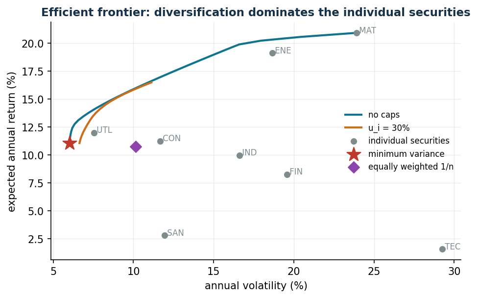

---
hide:
  - navigation
  - toc
---

# Operations Research Lab

<!-- collana-riga -->

A course of the <b>Operations Research and Mathematics</b> series · [all the courses](#the-series)

<!-- /collana-riga -->

Teaching material designed and developed by **[Fabio Furini](https://fabiofurini.github.io/)**, associate
professor at [DIAG](https://www.diag.uniroma1.it/), Sapienza University of Rome.

**Continuous optimization models** — the course lecture
notes in online form, with Python/Gurobi code, data and reproducible case
studies.

Every chapter starts from a concrete managerial problem — how much to produce, where
to locate a service, which price to set, how much risk to accept — turns it
into an optimization model, solves it with Gurobi called from Python and, above all,
*interrogates* it: how much is one extra hour of capacity worth? Does the solution hold if the data
change by 5%?

Every model can be run **right away in the browser**: each chapter has its own
[notebook that opens in Colab](notebooks.md), with nothing to install.

!!! tip "The right question"
    At the end of every lab session the question is not only *“what is the optimum?”*,
    but *“which decision do we recommend and how robust is it?”*. All the decision
    variables are **continuous**; depending on the class of the model we read the
    solution through LP/QP duality, shadow prices or the KKT conditions.

[Start :material-arrow-right:](tools.md){ .md-button .md-button--primary }
[:material-clipboard-check-outline: Quiz](self-assessment.md){ .md-button }
[:material-download: Downloads](downloads.md){ .md-button }

<!-- collana-app -->
## Try it now

Markowitz's efficient frontier: every point is an optimal portfolio for a level of risk. Open the notebook in Colab, change the data and solve it again with Gurobi, with nothing to install.

[:simple-googlecolab: Open the notebook in Colab](https://colab.research.google.com/github/fabiofurini/operations-research-lab/blob/main/notebooks/lab06_markowitz.ipynb){ .md-button .md-button--primary }
[:material-book-open-variant: The chapter](markowitz.md){ .md-button }
[:material-language-python: All the notebooks](notebooks.md){ .md-button }
<!-- /collana-app -->

## The parts of the course

-   :material-hammer-wrench: **Tools**

    ---

    How a model is built, how it is run, how to read the solution, the shadow
    prices and the reduced costs: the theory and the solver.

    [:octicons-arrow-right-24: The four chapters](tools.md)

-   :material-factory: **Deterministic models**

    ---

    Production, supply chain, portfolio, pricing, budget, location, electric
    vehicle charging, queues, branch efficiency: every datum is known.

    [:octicons-arrow-right-24: The nine problems](deterministic-models.md)

-   :material-dice-multiple: **Decisions under uncertainty**

    ---

    You decide before you know: the quantile rule, tail risk and the duality that
    prices financial instruments.

    [:octicons-arrow-right-24: The three problems](decisions-uncertainty.md)

-   :material-robot: **Optimization and machine learning**

    ---

    The SVM as a convex QP and robust regression as an LP: margin, dual, support
    vectors and support points — without ML libraries.

    [:octicons-arrow-right-24: The two problems](optimization-ml.md)

<!-- collana-da-non-perdere -->
## Don't miss

-   :material-clipboard-check-outline: **Self-assessment quiz**

    ---

    A new mock exam at every start: 13 questions, 33 points, with the solution and the link to the notes. Downloads also has the full question bank.

    [:octicons-arrow-right-24: Test yourself](self-assessment.md)

-   :material-download: **Lecture notes in PDF**

    ---

    Lecture notes, exercise books and slides in PDF, with the same numbering as the website.

    [:octicons-arrow-right-24: Downloads](downloads.md)

-   :material-language-python: **Notebooks in Colab**

    ---

    The code of the course running in the browser, with nothing to install.

    [:octicons-arrow-right-24: The notebooks](notebooks.md)

<!-- /collana-da-non-perdere -->

---

<!-- collana -->
## The series

Ten courses built the same way: lecture notes online and in PDF, exercises with solutions, an interactive lab and self-assessment quizzes.

-   :material-function-variant: **[Mathematical Analysis 1](https://fabiofurini.github.io/mathematical-analysis-1/)**

    real numbers, functions, limits, derivatives and series, with interactive graphs

-   :material-matrix: **[Linear Algebra](https://fabiofurini.github.io/linear-algebra/)**

    vectors, matrices, determinants, linear systems and eigenvalues, with the computation lab

-   :material-code-braces: **[Algorithms](https://fabiofurini.github.io/algorithms/)**

    number representation, pseudo-code, sorting and searching, analysis and recursive algorithms

-   :material-vector-triangle: **[Linear Programming](https://fabiofurini.github.io/linear-programming/)**

    polyhedra, the simplex algorithm, duality and the dual simplex, with the interactive lab

-   :material-dots-grid: **[Integer Linear Programming](https://fabiofurini.github.io/integer-linear-programming/)**

    LP relaxation, valid inequalities, cutting planes, branch-and-bound and branch-and-cut

-   :material-vector-curve: **[Convex Optimization](https://fabiofurini.github.io/convex-optimization/)**

    convex sets and functions, convex optimization problems, with interactive graphs

-   :material-graph-outline: **[Network Optimization](https://fabiofurini.github.io/network-optimization/)**

    graphs, spanning trees, shortest paths, network flows, the network simplex and project management

-   :material-hexagon-multiple-outline: **[Combinatorial Optimization](https://fabiofurini.github.io/combinatorial-optimization/)**

    knapsack, bin packing, coloring, TSP, scheduling and lot sizing, solved in every way

-   :material-vector-polygon: **[MIP Modelling](https://fabiofurini.github.io/mip-modelling/)**

    integer linear programming models, from the formulation to the solution with solvers

-   :material-chart-timeline-variant: **Operations Research Lab** · *this course*

    modelling and solving optimization problems with Python and solvers

<!-- /collana -->

---

Teaching material by **[Fabio Furini](https://fabiofurini.github.io/)** —
[DIAG](https://www.diag.uniroma1.it/), Sapienza University of Rome.
